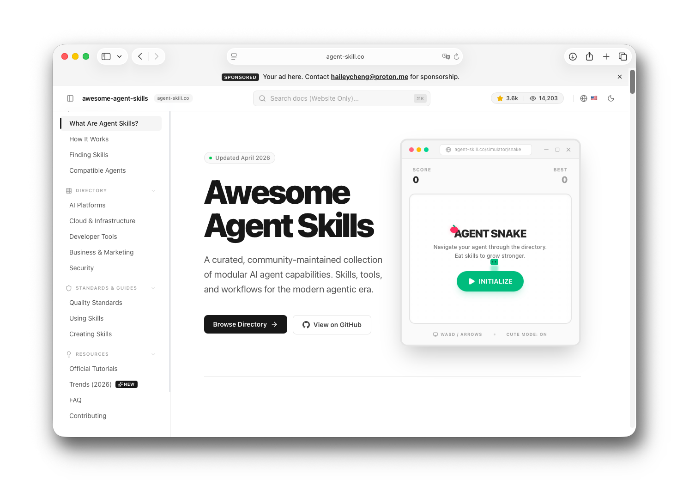
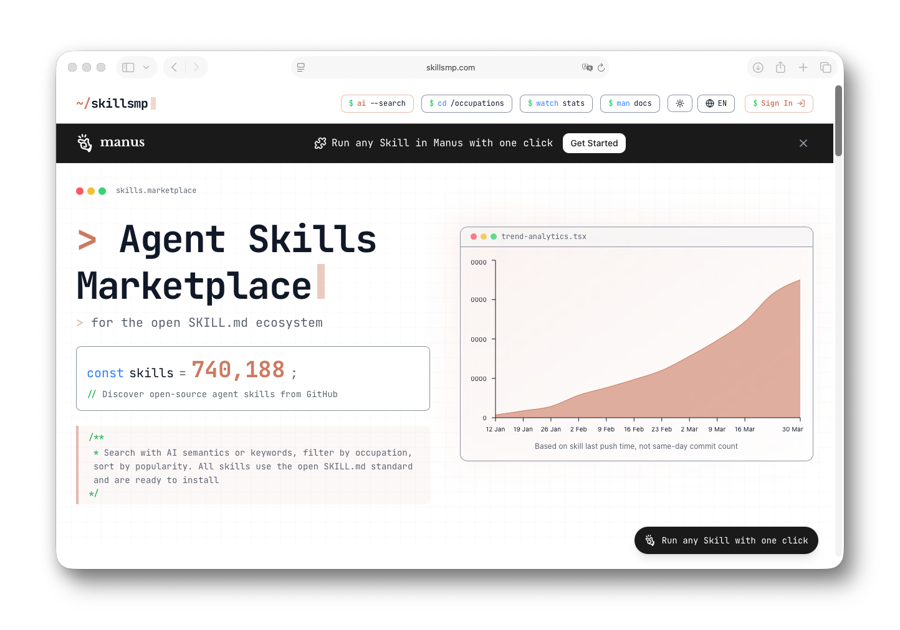
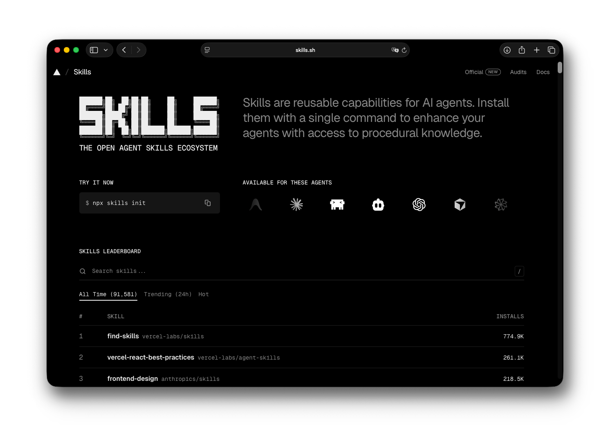

# Agent Skill Index

[English](README.md) | [繁體中文](README.zh-TW.md) | [簡體中文](README.zh-CN.md) | [日本語](README.ja.md) | [한국어](README.ko.md) | [Español](README.es.md)

[](https://agent-skill.co)

> 🌐 在 **[agent-skill.co](https://agent-skill.co)** 瀏覽即時目錄

維護者：[Hailey Cheng (Cheng Hei Lam)](https://www.linkedin.com/in/heilcheng/) · X [@haileyhmt](https://x.com/haileyhmt) · [haileycheng@proton.me](mailto:haileycheng@proton.me)

從未聽說過「agent skills」？你來對地方了。這是一份由社群精選的清單，收錄了簡單的文字檔案，能教 AI 助理（如 Claude、Copilot 或 Codex）按需學習新能力，無需重新訓練。與大量生成的技能庫不同，本集合專注於由實際工程團隊建立並使用的真實世界 Agent 技能。相容於 Claude Code、Codex、Antigravity、Gemini CLI、Cursor、GitHub Copilot、Windsurf 等。

---

## 快速開始（30 秒）

**步驟 1：從下方目錄中選擇一個技能**（或瀏覽 [agent-skill.co](https://agent-skill.co)）

**步驟 2：將其載入您的 AI 代理：**
- Claude Code：`/skills add <github-url>`
- Claude.ai：在新對話中貼上 SKILL.md 的原始 URL
- Codex / Copilot：遵循 [使用技能](#使用技能) 中連結的平台文件
- Autohand Code：對已收錄的技能使用 `autohand --skill-install <skill-name>`，或將技能資料夾複製到 `~/.autohand/skills/`

**步驟 3：要求您的 AI 使用它。** 只需用簡單的中文或英文描述您的需求。

就這樣。無需安裝。無需配置。無需編程。

---

## 目錄

- [什麼是 Agent Skills？](#什麼是-agent-skills)
- [如何找到技能（推薦）](#如何找到技能推薦)
- [相容的代理](#相容的代理)
- [官方技能目錄](#官方技能目錄)
  - [AI 平台與模型](#ai-平台與模型)
  - [雲端與基礎設施](#雲端與基礎設施)
  - [開發者工具與框架](#開發者工具與框架)
  - [Google 生態系統](#google-生態系統)
  - [商業、生產力與行銷](#商業生產力與行銷)
  - [安全與網絡情報](#安全與網絡情報)
- [社群技能](#社群技能)
- [技能品質標準](#技能品質標準)
- [使用技能](#使用技能)
- [建立技能](#建立技能)
- [官方教學與指南](#官方教學與指南)
- [趨勢與能力 (2026)](#趨勢與能力-2026)
- [常見問題](#常見問題)
- [相關 Awesome 清單](#相關-awesome-清單)
- [貢獻](#貢獻)
- [聯絡方式](#聯絡方式)
- [引用](#引用)
- [授權](#授權)

---

## 什麼是 Agent Skills？

將 **Agent Skills** 想像成 AI 助理的「操作指南」。AI 不需要預先知道所有事情，技能讓它可以隨時學習新能力，就像給人一張食譜卡，而不是讓他們背誦整本食譜書。

技能是簡單的文字檔案（稱為 `SKILL.md`），教導 AI 如何執行特定任務。當您要求 AI 做某件事時，它會找到正確的技能，閱讀指令，然後開始工作。

### 運作方式

技能分三個階段載入：

1. **瀏覽**：AI 看到可用技能列表（只有名稱和簡短描述）
2. **載入**：當需要技能時，AI 會閱讀完整指令
3. **使用**：AI 遵循指令並存取任何輔助檔案

### 為什麼這很重要

- **更快更輕量**：AI 只在需要時載入所需內容
- **隨處可用**：建立一次技能，即可在任何相容的 AI 工具中使用
- **易於分享**：技能只是您可以複製、下載或在 GitHub 分享的檔案

技能是**指令**，不是程式碼。AI 像人類閱讀指南一樣閱讀它們，然後遵循步驟。

---

## 如何找到技能（推薦）

### SkillsMP 市場

[](https://skillsmp.com)

推薦使用 **[SkillsMP 市場](https://skillsmp.com)**，它會自動索引 GitHub 上的所有 Skill 專案，並按類別、更新時間、星數和其他標籤進行組織——這是發現和評估技能最簡單的方法。

### skills.sh 排行榜 (由 Vercel 提供)

[](https://skills.sh)

您也可以使用 **[skills.sh](https://skills.sh)** —— Vercel 的排行榜 —— 直觀地查看最受歡迎的 Skills 倉庫和單個技能的使用統計數據。

### WorkBuddy Skill Atlas

對於 WorkBuddy 使用者，**[WorkBuddy Skill Atlas](https://sandbaseai.github.io/workbuddy-skill/zh-CN.html)** 收錄超過 10,000 個公開 `SKILL.md` 路徑，提供不可變 GitHub 來源、重複偵測、相容度評分和保守的靜態審查訊號。複製目錄 ID 後，可用其開源適配器產生便於審查的 WorkBuddy 技能包。

### npx skills CLI 工具

對於特定技能，使用 `npx skills` 命令行工具快速發現、添加和管理技能。詳細參數請參閱 [vercel-labs/skills](https://github.com/vercel-labs/skills)。

```bash
npx skills find [query]            # 搜尋相關技能
npx skills add <owner/repo>        # 安裝技能（支援 GitHub 簡寫、完整 URL、本地路徑）
npx skills list                    # 列出已安裝技能
npx skills check                   # 檢查可用更新
npx skills update                  # 升級所有技能
npx skills remove [skill-name]     # 卸載技能
```

---

## 相容的代理

---

<!-- sync:agents:start -->
| 代理 | 文件 |
|-------|---------------|
| Claude Code | [code.claude.com/docs/en/skills](https://code.claude.com/docs/en/skills) |
| Claude.ai | [support.claude.com](https://support.claude.com/en/articles/12512180-using-skills-in-claude) |
| Codex (OpenAI) | [developers.openai.com](https://developers.openai.com/codex/skills) |
| GitHub Copilot | [docs.github.com](https://docs.github.com/copilot/concepts/agents/about-agent-skills) |
| VS Code | [code.visualstudio.com](https://code.visualstudio.com/docs/copilot/customization/agent-skills) |
| Antigravity | [antigravity.google](https://antigravity.google/docs/skills) |
| Kiro | [kiro.dev](https://kiro.dev/docs/skills/) |
| Gemini CLI | [geminicli.com](https://geminicli.com/docs/cli/skills/) |
| Junie | [junie.jetbrains.com](https://junie.jetbrains.com/docs/agent-skills.html) |
| Autohand Code | [github.com/autohandai/code-cli](https://github.com/autohandai/code-cli) |
<!-- sync:agents:end -->

---

<!-- sync:directory:start -->
## 官方技能目錄

### AI 平台與模型

#### Anthropic 技能
官方內建技能，用於常見文件類型和創意工作流程。
- [anthropics/docx](https://github.com/anthropics/skills/tree/main/skills/docx) - 建立、編輯和分析 Word 文件
- [anthropics/doc-coauthoring](https://github.com/anthropics/skills/tree/main/skills/doc-coauthoring) - 協作式文件編輯與共同創作
- [anthropics/pptx](https://github.com/anthropics/skills/tree/main/skills/pptx) - 建立、編輯和分析 PowerPoint 簡報
- [anthropics/xlsx](https://github.com/anthropics/skills/tree/main/skills/xlsx) - 建立、編輯和分析 Excel 試算表
- [anthropics/pdf](https://github.com/anthropics/skills/tree/main/skills/pdf) - 提取文字、建立 PDF 並處理表單
- [anthropics/algorithmic-art](https://github.com/anthropics/skills/tree/main/skills/algorithmic-art) - 使用 p5.js 建立生成藝術
- [anthropics/canvas-design](https://github.com/anthropics/skills/tree/main/skills/canvas-design) - 設計 PNG 和 PDF 格式的視覺藝術
- [anthropics/frontend-design](https://github.com/anthropics/skills/tree/main/skills/frontend-design) - 前端設計與 UI/UX 開發工具
- [anthropics/slack-gif-creator](https://github.com/anthropics/skills/tree/main/skills/slack-gif-creator) - Create animated GIFs optimized for Slack size constraints
- [anthropics/theme-factory](https://github.com/anthropics/skills/tree/main/skills/theme-factory) - Style artifacts with professional themes or generate custom themes
- [anthropics/web-artifacts-builder](https://github.com/anthropics/skills/tree/main/skills/web-artifacts-builder) - Build complex claude.ai HTML artifacts with React and Tailwind
- [anthropics/mcp-builder](https://github.com/anthropics/skills/tree/main/skills/mcp-builder) - Create MCP servers to integrate external APIs and services
- [anthropics/webapp-testing](https://github.com/anthropics/skills/tree/main/skills/webapp-testing) - 使用 Playwright 測試本地網頁應用
- [anthropics/brand-guidelines](https://github.com/anthropics/skills/tree/main/skills/brand-guidelines) - Apply Anthropic's brand colors and typography to artifacts
- [anthropics/internal-comms](https://github.com/anthropics/skills/tree/main/skills/internal-comms) - Write status reports, newsletters, and FAQs
- [anthropics/skill-creator](https://github.com/anthropics/skills/tree/main/skills/skill-creator) - Guide for creating skills that extend Claude's capabilities
- [anthropics/template](https://github.com/anthropics/skills/tree/main/template) - Basic template for creating new skills

#### OpenAI (Codex) 技能
來自 OpenAI 目錄的官方精選技能。
- [openai/cloudflare-deploy](https://github.com/openai/skills/tree/main/skills/.curated/cloudflare-deploy) - 使用 Workers 和 Pages 部署到 Cloudflare
- [openai/develop-web-game](https://github.com/openai/skills) - Build and test web games iteratively using Playwright
- [openai/doc](https://github.com/openai/skills) - Read, create, and edit .docx documents with formatting
- [openai/gh-address-comments](https://github.com/openai/skills/tree/main/skills/.curated/gh-address-comments) - Address review and issue comments on open GitHub PRs via CLI
- [openai/gh-fix-ci](https://github.com/openai/skills/tree/main/skills/.curated/gh-fix-ci) - Debug and fix failing GitHub Actions PR checks
- [openai/imagegen](https://github.com/openai/skills/tree/main/skills/.system/imagegen) - 使用 OpenAI Image API 生成圖像
- [openai/jupyter-notebook](https://github.com/openai/skills/tree/main/skills/.curated/jupyter-notebook) - 建立乾淨、可重現的 Jupyter 筆記本
- [openai/linear](https://github.com/openai/skills/tree/main/skills/.curated/linear) - Manage issues, projects, and team workflows in Linear
- [openai/netlify-deploy](https://github.com/openai/skills/tree/main/skills/.curated/netlify-deploy) - Automate Netlify deployments with CLI support
- [openai/notion-knowledge-capture](https://github.com/openai/skills/tree/main/skills/.curated/notion-knowledge-capture) - Convert conversations into structured Notion wiki entries
- [openai/pdf](https://github.com/openai/skills/tree/main/skills/.curated/pdf) - Read, create, and review PDFs with layout integrity
- [openai/playwright](https://github.com/openai/skills/tree/main/skills/.curated/playwright) - Automate real browser interactions for navigation and forms
- [openai/sora](https://github.com/openai/skills) - Generate, remix, and manage short video clips via Sora API
- [openai/speech](https://github.com/openai/skills/tree/main/skills/.curated/speech) - Generate spoken audio from text using OpenAI's API
- [openai/spreadsheet](https://github.com/openai/skills) - Create, edit, analyze, and visualize spreadsheets
- [openai/figma](https://github.com/openai/skills/tree/main/skills/.curated/figma) - Use the Figma MCP server to fetch design context
- [openai/figma-implement-design](https://github.com/openai/skills/tree/main/skills/.curated/figma-implement-design) - 將 Figma 設計轉化為生產就緒的程式碼
- [openai/frontend-skill](https://github.com/openai/skills) - Create visually strong landing pages and web apps

#### Google Gemini 技能
安裝來源：[google-gemini/gemini-api-dev](https://github.com/google-gemini/gemini-skills/tree/main/skills/gemini-api-dev)。
- [google-gemini/gemini-api-dev](https://github.com/google-gemini/gemini-skills/tree/main/skills/gemini-api-dev) - 開發 Gemini 驅動應用的最佳實務
- [google-gemini/vertex-ai-api-dev](https://github.com/google-gemini/gemini-skills) - 在 Google Cloud Vertex AI 上開發 Gemini 應用
- [google-gemini/gemini-live-api-dev](https://github.com/google-gemini/gemini-skills/tree/main/skills/gemini-live-api-dev) - Building real-time bidirectional streaming apps
- [google-gemini/gemini-interactions-api](https://github.com/google-gemini/gemini-skills) - Text, chat, streaming, and image generation

#### Hugging Face 技能
用於機器學習工作流程的官方技能。
- [huggingface/hf-cli](https://github.com/huggingface/skills/tree/main/skills/hf-cli) - HF CLI tool for Hub operations
- [huggingface/hugging-face-datasets](https://github.com/huggingface/skills/tree/main/skills/huggingface-datasets) - Create and manage datasets with SQL querying
- [huggingface/hugging-face-model-trainer](https://github.com/huggingface/skills) - Train models with TRL: SFT, DPO, GRPO
- [huggingface/transformers.js](https://github.com/huggingface/skills/tree/main/skills/transformers-js) - Run ML models in the browser with Transformers.js

#### Replicate 技能
- [replicate/replicate](https://github.com/replicate/skills) - Discover and run AI models via API

#### fal.ai 技能
- [fal-ai-community/fal-generate](https://github.com/fal-ai-community/skills) - Generate images and videos using fal.ai
- [fal-ai-community/fal-realtime](https://github.com/fal-ai-community/skills) - Real-time and streaming AI image generation
- [fal-ai-community/fal-upscale](https://github.com/fal-ai-community/skills) - Upscale and enhance image resolution

#### MiniMax 技能
- [MiniMax-AI/frontend-dev](https://github.com/MiniMax-AI/skills/tree/main/skills/frontend-dev) - Frontend with animations and AI media via MiniMax
- [MiniMax-AI/minimax-pdf](https://github.com/MiniMax-AI/skills/tree/main/skills/minimax-pdf) - Generate, fill, and reformat PDFs

#### Bria AI 技能
- [Bria-AI/bria-ai](https://github.com/Bria-AI/bria-skill/tree/main/skills/bria-ai) - AI image generation, editing, and background removal API
- [Bria-AI/remove-background](https://github.com/Bria-AI/bria-skill/tree/main/skills/remove-background) - Remove image backgrounds for transparent PNGs and cutouts
- [Bria-AI/video-remove-background](https://github.com/Bria-AI/bria-skill/tree/main/skills/video-remove-background) - Remove video backgrounds for transparent, alpha-channel clips
- [Bria-AI/vgl](https://github.com/Bria-AI/bria-skill/tree/main/skills/vgl) - Structured JSON control over AI image generation (FIBO)
- [Bria-AI/image-utils](https://github.com/Bria-AI/bria-skill/tree/main/skills/image-utils) - Resize, crop, composite, and convert images with Pillow

### 雲端與基礎設施

#### Cloudflare 技能
- [cloudflare/agents-sdk](https://github.com/cloudflare/skills/tree/main/skills/agents-sdk) - Build stateful AI agents with scheduling, RPC, and MCP servers
- [cloudflare/building-ai-agent-on-cloudflare](https://github.com/cloudflare/skills) - Build AI agents with state and WebSockets on Cloudflare
- [cloudflare/building-mcp-server-on-cloudflare](https://github.com/cloudflare/skills) - Build remote MCP servers with tools and OAuth
- [cloudflare/durable-objects](https://github.com/cloudflare/skills/tree/main/skills/durable-objects) - Stateful coordination with RPC, SQLite, and WebSockets
- [cloudflare/web-perf](https://github.com/cloudflare/skills/tree/main/skills/web-perf) - Audit Core Web Vitals and render-blocking resources
- [cloudflare/wrangler](https://github.com/cloudflare/skills/tree/main/skills/wrangler) - Deploy and manage Workers, KV, R2, D1, Vectorize, Queues, Workflows

#### Netlify 技能
- [netlify/netlify-functions](https://github.com/netlify/context-and-tools/tree/main/skills/netlify-functions) - Build serverless API endpoints and background tasks
- [netlify/netlify-edge-functions](https://github.com/netlify/context-and-tools/tree/main/skills/netlify-edge-functions) - Low-latency edge middleware and geolocation logic
- [netlify/netlify-blobs](https://github.com/netlify/context-and-tools/tree/main/skills/netlify-blobs) - Key-value object storage for files and data
- [netlify/netlify-db](https://github.com/netlify/context-and-tools/tree/main/skills/netlify-database) - Managed Postgres with deploy preview branching
- [netlify/netlify-deploy](https://github.com/netlify/context-and-tools/tree/main/skills/netlify-deploy) - Automated deployment workflow for Netlify sites
- [netlify/netlify-ai-gateway](https://github.com/netlify/context-and-tools/tree/main/skills/netlify-ai-gateway) - Access AI models via unified gateway endpoint

#### Vercel 技能
- [vercel-labs/react-best-practices](https://github.com/vercel-labs/agent-skills/tree/main/skills/react-best-practices) - React best practices and patterns
- [vercel-labs/web-design-guidelines](https://github.com/vercel-labs/agent-skills/tree/main/skills/web-design-guidelines) - Web design guidelines and standards
- [vercel-labs/next-best-practices](https://github.com/vercel-labs/agent-skills) - Next.js best practices and recommended patterns
- [vercel-labs/next-cache-components](https://github.com/vercel-labs/agent-skills) - Caching strategies and cache-aware components in Next.js
- [vercel-labs/react-native-skills](https://github.com/vercel-labs/agent-skills/tree/main/skills/react-native-skills) - React Native best practices and performance guidelines

#### HashiCorp (Terraform) 技能
- [hashicorp/new-terraform-provider](https://github.com/hashicorp/agent-skills/tree/main/plugins/terraform/skills/new-terraform-provider) - Scaffold a new Terraform provider project using the Plugin Framework
- [hashicorp/provider-resources](https://github.com/hashicorp/agent-skills/tree/main/plugins/terraform/skills/provider-resources) - Implement Terraform Provider resources and data sources
- [hashicorp/provider-test-patterns](https://github.com/hashicorp/agent-skills/tree/main/plugins/terraform/skills/provider-test-patterns) - Acceptance test patterns for Terraform providers
- [hashicorp/refactor-module](https://github.com/hashicorp/agent-skills/tree/main/plugins/terraform/skills/refactor-module) - Transform monolithic Terraform configurations into reusable modules
- [hashicorp/terraform-style-guide](https://github.com/hashicorp/agent-skills/tree/main/plugins/terraform/skills/terraform-style-guide) - Generate Terraform HCL code following HashiCorp's official style conventions
- [hashicorp/terraform-stacks](https://github.com/hashicorp/agent-skills/tree/main/plugins/terraform/skills/terraform-stacks) - Manage infrastructure across multiple environments, regions, and cloud accounts

#### Neon 技能
- [neondatabase/neon-postgres](https://github.com/neondatabase/agent-skills/tree/main/skills/neon-postgres) - Best practices for Neon Serverless Postgres
- [neondatabase/claimable-postgres](https://github.com/neondatabase/mcp-server-neon/tree/main/.agents/skills/claimable-postgres) - Claimable Postgres database provisioning with Neon
- [neondatabase/neon-postgres-egress-optimizer](https://github.com/neondatabase/agent-skills/tree/main/skills/neon-postgres-egress-optimizer) - Optimize Neon Postgres egress and data transfer

#### ClickHouse 技能
- [clickhouse/clickhouse-best-practices](https://github.com/ClickHouse/agent-skills/tree/main/skills/clickhouse-best-practices) - Best practices for working with ClickHouse

#### Supabase 技能
- [supabase/postgres-best-practices](https://github.com/supabase/agent-skills/tree/main/skills/supabase-postgres-best-practices) - PostgreSQL best practices for Supabase

#### Tinybird 技能
- [tinybirdco/tinybird-best-practices](https://github.com/tinybirdco/tinybird-agent-skills/tree/main/skills/tinybird-best-practices) - Tinybird project guidelines for datasources, pipes, endpoints, and SQL
- [tinybirdco/tinybird-cli-guidelines](https://github.com/tinybirdco/tinybird-agent-skills/tree/main/skills/tinybird-cli-guidelines) - Tinybird CLI usage guidelines and commands
- [tinybirdco/tinybird-typescript-sdk-guidelines](https://github.com/tinybirdco/tinybird-agent-skills/tree/main/skills/tinybird-typescript-sdk-guidelines) - Tinybird TypeScript SDK usage guidelines

---

### 開發者工具與框架

#### VoltAgent 技能
- [voltagent/create-voltagent](https://github.com/VoltAgent/skills/tree/main/skills/create-voltagent) - Project setup guide with CLI and manual steps
- [voltagent/voltagent-best-practices](https://github.com/VoltAgent/skills/tree/main/skills/voltagent-best-practices) - Architecture and usage patterns for agents, workflows, memory, and servers
- [voltagent/voltagent-core-reference](https://github.com/VoltAgent/skills/tree/main/skills/voltagent-core-reference) - Reference for the VoltAgent class options and lifecycle methods
- [voltagent/voltagent-docs-bundle](https://github.com/VoltAgent/skills/tree/main/skills/voltagent-docs-bundle) - Lookup embedded docs from @voltagent/core for version-matched documentation

#### CallStack 技能
- [callstackincubator/react-native-best-practices](https://github.com/callstackincubator/agent-skills/tree/main/skills/react-native-best-practices) - Performance optimization for React Native apps
- [callstackincubator/github](https://github.com/callstackincubator/agent-skills) - GitHub workflow patterns for PRs, code review, branching
- [callstackincubator/upgrading-react-native](https://github.com/callstackincubator/agent-skills/tree/main/skills/upgrading-react-native) - React Native upgrade workflow: templates, dependencies, and pitfalls

#### Expo 技能
- [expo/building-native-ui](https://github.com/expo/skills/tree/main/plugins/expo/skills/expo-native-ui) - Build apps with Expo Router, styling, components, and animations
- [expo/expo-api-routes](https://github.com/expo/skills/tree/main/plugins/expo/skills/expo-router) - Create API routes in Expo Router with EAS Hosting
- [expo/expo-deployment](https://github.com/expo/skills/tree/main/plugins/expo/skills/eas-hosting) - Deploy Expo apps to production
- [expo/upgrading-expo](https://github.com/expo/skills/tree/main/plugins/expo/skills/expo-upgrade) - Upgrade Expo SDK versions
- [expo/use-dom](https://github.com/expo/skills/tree/main/plugins/expo/skills/expo-dom) - Run web code in a webview on native using DOM components

#### Remotion 技能
- [remotion-dev/remotion](https://github.com/remotion-dev/skills) - Programmatic video creation with React

#### DuckDB 技能
- [duckdb/attach-db](https://github.com/duckdb/duckdb-skills/tree/main/skills/attach-db) - Attach a DuckDB database file for interactive querying
- [duckdb/query](https://github.com/duckdb/duckdb-skills/tree/main/skills/query) - Run SQL queries against attached databases or ad-hoc files
- [duckdb/duckdb-docs](https://github.com/duckdb/duckdb-skills/tree/main/skills/duckdb-docs) - Search DuckDB and DuckLake documentation

#### GSAP (GreenSock) 技能
- [greensock/gsap-core](https://github.com/greensock/gsap-skills/tree/main/skills/gsap-core) - Core API: gsap.to(), from(), fromTo(), easing, duration, stagger
- [greensock/gsap-scrolltrigger](https://github.com/greensock/gsap-skills/tree/main/skills/gsap-scrolltrigger) - ScrollTrigger for scroll-linked animations and pinning
- [greensock/gsap-react](https://github.com/greensock/gsap-skills/tree/main/skills/gsap-react) - React integration with useGSAP hook and SSR patterns

#### Markstream 技能

安裝來源：[Simon-He95/markstream-vue](https://github.com/Simon-He95/markstream-vue/tree/main/.agents/skills)。

| 技能 | 說明 |
|-------|-------------|
| [markstream-angular](https://github.com/Simon-He95/markstream-vue/tree/main/.agents/skills/markstream-angular) | Integrate streaming Markdown into Angular apps |
| [markstream-custom-components](https://github.com/Simon-He95/markstream-vue/tree/main/.agents/skills/markstream-custom-components) | Add scoped renderer overrides and trusted custom tags |
| [markstream-install](https://github.com/Simon-He95/markstream-vue/tree/main/.agents/skills/markstream-install) | Choose and install the correct framework package and peers |
| [markstream-migration](https://github.com/Simon-He95/markstream-vue/tree/main/.agents/skills/markstream-migration) | Migrate existing Markdown renderers while preserving behavior |
| [markstream-nuxt](https://github.com/Simon-He95/markstream-vue/tree/main/.agents/skills/markstream-nuxt) | Configure SSR-safe streaming Markdown in Nuxt 3 and Nuxt 4 |
| [markstream-react](https://github.com/Simon-He95/markstream-vue/tree/main/.agents/skills/markstream-react) | Integrate streaming Markdown into React and Next.js apps |
| [markstream-svelte](https://github.com/Simon-He95/markstream-vue/tree/main/.agents/skills/markstream-svelte) | Integrate streaming Markdown into Svelte 5 apps |
| [markstream-vue](https://github.com/Simon-He95/markstream-vue/tree/main/.agents/skills/markstream-vue) | Integrate streaming Markdown into Vue 3 apps |
| [markstream-vue2](https://github.com/Simon-He95/markstream-vue/tree/main/.agents/skills/markstream-vue2) | Integrate streaming Markdown into Vue 2.6 and Vue 2.7 apps |
| [markstream-vue2-cli](https://github.com/Simon-He95/markstream-vue/tree/main/.agents/skills/markstream-vue2-cli) | Configure Vue CLI and Webpack 4-compatible Vue 2 rendering |
| [markstream-vue2-vite](https://github.com/Simon-He95/markstream-vue/tree/main/.agents/skills/markstream-vue2-vite) | Configure Vue 2 and Vite worker imports and CSS |

#### WordPress 技能
- [WordPress/wp-block-development](https://github.com/WordPress/agent-skills/tree/trunk/skills/wp-block-development) - Gutenberg blocks: block.json, attributes, rendering
- [WordPress/wp-plugin-development](https://github.com/WordPress/agent-skills/tree/trunk/skills/wp-plugin-development) - Plugin architecture, hooks, settings API, security
- [WordPress/wp-playground](https://github.com/WordPress/agent-skills/tree/trunk/skills/wp-playground) - WordPress Playground for instant local environments

#### Figma 技能
- [figma/figma-implement-design](https://github.com/openai/skills/tree/main/skills/.curated/figma-implement-design) - Translate Figma designs into production-ready code with 1:1 fidelity
- [figma/figma-generate-library](https://github.com/figma/mcp-server-guide/tree/main/skills/figma-generate-library) - Build or update a design system library in Figma from a codebase
- [figma/figma-use](https://github.com/figma/mcp-server-guide/tree/main/skills/figma-use) - Run Figma Plugin API scripts for canvas writes and inspections

---

#### Ivy 技能
- [Ivy Tendril](https://github.com/Ivy-Interactive/Ivy-Tendril) - Open-source agentic software factory with an amazing UI that handles parallel Git worktrees for you, complete with programmatic verifications and fast review loops.

### Google 生態系統

#### Google Labs (Stitch) 技能
- [google-labs-code/design-md](https://github.com/google-labs-code/stitch-skills/tree/main/plugins/stitch-utilities/skills/design-md) - Create and manage DESIGN.md files
- [google-labs-code/enhance-prompt](https://github.com/google-labs-code/stitch-skills/tree/main/plugins/stitch-utilities/skills/enhance-prompt) - Improve prompts with design specs and UI/UX vocabulary
- [google-labs-code/react-components](https://github.com/google-labs-code/stitch-skills/tree/main/plugins/stitch-build/skills/react-components) - Stitch to React components conversion
- [google-labs-code/shadcn-ui](https://github.com/google-labs-code/stitch-skills/tree/main/plugins/stitch-build/skills/shadcn-ui) - Build UI components with shadcn/ui
- [google-labs-code/stitch-loop](https://github.com/google-labs-code/stitch-skills/tree/main/plugins/stitch-utilities/skills/stitch-loop) - Iterative design-to-code feedback loop

#### Google Workspace CLI 技能
- [googleworkspace/gws-drive](https://github.com/googleworkspace/cli/tree/main/skills/gws-drive) - Manage Google Drive files, folders, and shared drives
- [googleworkspace/gws-sheets](https://github.com/googleworkspace/cli/tree/main/skills/gws-sheets) - Read and write Google Sheets spreadsheets
- [googleworkspace/gws-gmail](https://github.com/googleworkspace/cli/tree/main/skills/gws-gmail) - Send, read, and manage Gmail email
- [googleworkspace/gws-calendar](https://github.com/googleworkspace/cli/tree/main/skills/gws-calendar) - Manage Google Calendar calendars and events
- [googleworkspace/gws-workflow](https://github.com/googleworkspace/cli/tree/main/skills/gws-workflow) - Cross-service Google Workspace productivity workflows

---

### 商業、生產力與行銷

#### Stripe 技能
- [stripe/stripe-best-practices](https://github.com/stripe/ai/tree/main/skills/stripe-best-practices) - Best practices for building Stripe integrations
- [stripe/upgrade-stripe](https://github.com/stripe/ai/tree/main/skills/upgrade-stripe) - Upgrade Stripe SDK and API versions

#### Courier 技能
- [trycourier/courier-skills](https://github.com/trycourier/courier-skills) - Multi-channel notifications via email, SMS, push, and chat

#### Typefully 技能
- [typefully/typefully](https://github.com/typefully/agent-skills/tree/main/skills/typefully) - Create, schedule, and publish social media content

#### SocialClaw 技能
- [ndesv21/socialclaw](https://github.com/ndesv21/socialclaw) - Schedule and publish social media posts across 13 platforms (X, LinkedIn, Instagram, Facebook Pages, TikTok, Discord, Telegram, YouTube, Reddit, WordPress, Pinterest) via a single workspace API key.

#### Surendran B 技能
- [surendranb/writing-skills](https://github.com/surendranb/writing-skills) - 15 writing-style skills: 8 measurable frameworks (plain language, ASD-STE100, AP journalism, GOV.UK, business BLUF) and 7 character voices, each with a verify checklist

#### Composio 技能
- [composiohq/composio](https://github.com/composio-community/skills/tree/main/skills/composio) - Connect AI agents to 1000+ external apps with managed authentication

#### Authsome 技能
- [agentrhq/authsome](https://github.com/agentrhq/authsome) - Local OAuth2 and API-key credential broker for AI agents. Login once via browser PKCE or device code, encrypted vault at ~/.authsome, local proxy injects credentials at request time. 30+ providers preconfigured.

#### Notion 技能
- [makenotion/knowledge-capture](https://github.com/makenotion/cursor-notion-plugin/tree/main/skills/knowledge-capture) - Transform conversations into structured Notion documentation
- [makenotion/meeting-intelligence](https://github.com/makenotion/cursor-notion-plugin/tree/main/skills/meeting-intelligence) - Prepare meeting materials by gathering Notion context
- [makenotion/spec-to-implementation](https://github.com/makenotion/cursor-notion-plugin/tree/main/skills/spec-to-implementation) - Turn tech specs into concrete Notion tasks

#### Resend 技能
- [resend/resend](https://github.com/resend/resend-skills/tree/main/skills/resend) - Send and manage emails via the Resend API
- [resend/react-email](https://github.com/resend/resend-skills/tree/main/skills/react-email) - Build emails with React Email components
- [resend/email-best-practices](https://github.com/resend/resend-skills/tree/main/skills/email-best-practices) - Email deliverability and design best practices

#### Sanity 技能
安裝來源：[sanity-io/agent-toolkit](https://github.com/sanity-io/agent-toolkit)。
- [sanity-io/sanity-best-practices](https://github.com/sanity-io/agent-toolkit/tree/main/skills/sanity-best-practices) - Best practices for Sanity Studio and content workflows
- [sanity-io/content-modeling-best-practices](https://github.com/sanity-io/agent-toolkit/tree/main/skills/content-modeling-best-practices) - Guidelines for designing scalable content models in Sanity
- [sanity-io/seo-aeo-best-practices](https://github.com/sanity-io/agent-toolkit/tree/main/skills/seo-aeo-best-practices) - SEO and answer engine optimization patterns

#### Better Auth 技能
- [better-auth/best-practices](https://github.com/better-auth/skills/tree/main/better-auth/best-practices) - Best practices for Better Auth integration
- [better-auth/create-auth](https://github.com/better-auth/skills/tree/main/better-auth/create-auth) - Create authentication setup with Better Auth
- [better-auth/twoFactor](https://github.com/better-auth/skills/tree/main/better-auth/twoFactor) - Two-factor authentication with Better Auth
- [better-auth/explain-error](https://github.com/better-auth/skills) - Explain Better Auth error messages

#### NotFair 技能
用於行銷工作的開源 SEO、GEO 與付費廣告技能。透過 Google Ads、Meta Ads、Google Search Console 與 Google Analytics (GA4) 的 MCP 取得即時資料，讓稽核以真實數據為依據。
- [nowork-studio/seo](https://github.com/nowork-studio/NotFair/tree/main/seo) - SEO and GEO: site analysis, keyword research, meta tags, schema markup, and content writing
- [nowork-studio/google-ads](https://github.com/nowork-studio/NotFair/tree/main/google-ads) - Google Ads audits: wasted-spend detection, search-term cleanup, keyword and bid management
- [nowork-studio/meta-ads](https://github.com/nowork-studio/NotFair/tree/main/meta-ads) - Meta (Facebook + Instagram) Ads: ROAS analysis, creative-fatigue and audience-overlap diagnosis

#### HumanPen 技能
- [humanpen/humanpen-skill](https://github.com/humanpen/humanpen-skill) - Rewrites .docx/.pptx documents to read as human-written and lower AI-detection scores

#### Product on Purpose 產品管理技能
- [product-on-purpose/pm-skills](https://github.com/product-on-purpose/pm-skills) - 68 product management skills covering discovery, definition, delivery, and iteration, with 6 sub-agents and 12 workflows

#### SuperCLI 技能
- [javimosch/supercli](https://github.com/javimosch/supercli) - Universal CLI router with 4,795+ agent skills (`SKILL.md`). Agents discover CLI tools by intent via `sc skills search`, inspect schemas via `sc inspect`, and execute with deterministic JSON output. Each plugin ships with its own `skills/quickstart/SKILL.md` — instant agent onboarding for 7,000+ CLI tools.

<details>
<summary><strong>Corey Haines 行銷技能</strong></summary>

[Corey Haines](https://github.com/coreyhaines31) 的完整 SaaS 行銷技能組合。
- [coreyhaines31/ai-seo](https://github.com/coreyhaines31/marketingskills/tree/main/skills/ai-seo) - Optimize content for AI-generated answers
- [coreyhaines31/copywriting](https://github.com/coreyhaines31/marketingskills/tree/main/skills/copywriting) - Write marketing copy for landing pages and ads
- [coreyhaines31/email-sequence](https://github.com/coreyhaines31/marketingskills) - Build email sequences and drip campaigns
- [coreyhaines31/page-cro](https://github.com/coreyhaines31/marketingskills) - Improve conversion rates on marketing pages
- [coreyhaines31/pricing-strategy](https://github.com/coreyhaines31/marketingskills/tree/main/skills/pricing) - Define pricing and packaging for SaaS
- [coreyhaines31/social-content](https://github.com/coreyhaines31/marketingskills/tree/main/skills/social) - Create and schedule social media content
</details>

<details>
<summary><strong>Dean Peters 產品管理技能</strong></summary>

[Dean Peters](https://github.com/deanpeters) 的 46 個實戰驗證產品管理技能。
- [deanpeters/epic-hypothesis](https://github.com/deanpeters/Product-Manager-Skills/tree/main/skills/epic-hypothesis) - Turn initiatives into testable hypotheses
- [deanpeters/opportunity-solution-tree](https://github.com/deanpeters/Product-Manager-Skills/tree/main/skills/opportunity-solution-tree) - Generate solution trees based on Teresa Torres' method
- [deanpeters/prd-development](https://github.com/deanpeters/Product-Manager-Skills/tree/main/skills/prd-development) - Structured PRD process: problem to metrics
- [deanpeters/roadmap-planning](https://github.com/deanpeters/Product-Manager-Skills/tree/main/skills/roadmap-planning) - Strategic roadmap process and communication
</details>

<details>
<summary><strong>Pawel Huryn 產品管理技能</strong></summary>

The Product Compass 作者 [Paweł Huryn](https://github.com/phuryn) 的 65 個產品管理技能。
- [phuryn/create-prd](https://github.com/phuryn/pm-skills/tree/main/pm-execution/skills/create-prd) - Create a PRD with 8-section template
- [phuryn/product-strategy](https://github.com/phuryn/pm-skills/tree/main/pm-product-strategy/skills/product-strategy) - Create product strategy using the Canvas
- [phuryn/user-personas](https://github.com/phuryn/pm-skills/tree/main/pm-market-research/skills/user-personas) - Create user personas with JTBD, pains, and gains
- [phuryn/market-sizing](https://github.com/phuryn/pm-skills/tree/main/pm-market-research/skills/market-sizing) - Estimate TAM, SAM, SOM with top-down and bottom-up
- [phuryn/pm-skills](https://github.com/phuryn/pm-skills) - Full collection: advanced product management frameworks, OKRs, and strategy skills
</details>

<details>
<summary><strong>Garry Tan (gstack) 技能</strong></summary>

[Garry Tan](https://github.com/garrytan) 的 28 個工程領導技能。
- [garrytan/office-hours](https://github.com/garrytan/gstack/tree/main/office-hours) - YC Office Hours: reframing product before code
- [garrytan/plan-ceo-review](https://github.com/garrytan/gstack/tree/main/plan-ceo-review) - CEO/Founder plan review modes
- [garrytan/design-review](https://github.com/garrytan/gstack/tree/main/design-review) - Visual audit and atomic fixes with screenshots
- [garrytan/qa](https://github.com/garrytan/gstack/tree/main/qa) - QA Lead: find bugs and generate regression tests
- [garrytan/ship](https://github.com/garrytan/gstack/tree/main/ship) - Release Engineer: sync, test, audit, and push
- [garrytan/gstack](https://github.com/garrytan/gstack) - Full gstack collection: YC founder stack for planning, review, QA, and shipping
</details>

---

### 安全與網絡情報

#### Trail of Bits 技能
- [trailofbits/audit-context-building](https://github.com/trailofbits/skills/tree/main/plugins/audit-context-building/skills/audit-context-building) - Deep architectural context via granular code analysis
- [trailofbits/building-secure-contracts](https://github.com/trailofbits/skills) - Smart contract security toolkit for 6 blockchains
- [trailofbits/modern-python](https://github.com/trailofbits/skills/tree/main/plugins/modern-python/skills/modern-python) - Modern Python tooling with uv, ruff, and pytest
- [trailofbits/static-analysis](https://github.com/trailofbits/skills) - Static analysis toolkit with CodeQL and Semgrep

#### Sentry 技能
- [getsentry/agents-md](https://github.com/getsentry/skills/tree/main/skills/agents-md) - Generate and manage AGENTS.md files
- [getsentry/code-review](https://github.com/getsentry/skills/tree/main/skills/code-review) - Perform structured code reviews
- [getsentry/find-bugs](https://github.com/getsentry/skills/tree/main/skills/find-bugs) - Find and identify bugs in code
- [getsentry/skills](https://github.com/getsentry/skills) - Full collection: debug errors, performance issues, and traces with Sentry

#### Firecrawl 技能
- [firecrawl/firecrawl-cli](https://github.com/firecrawl/cli/tree/main/skills/firecrawl) - Scrape, crawl, search, and map the web via CLI
- [firecrawl/firecrawl-agent](https://github.com/firecrawl/cli/tree/main/skills/firecrawl-agent) - AI agent for autonomous web scraping
- [firecrawl/firecrawl-browser](https://github.com/firecrawl/cli) - Browser-based web scraping and interaction
- [firecrawl/firecrawl-scrape](https://github.com/firecrawl/cli/tree/main/skills/firecrawl-scrape) - Scrape web pages and extract content
- [firecrawl/firecrawl-search](https://github.com/firecrawl/cli/tree/main/skills/firecrawl-search) - Search the web and extract results

<details>
<summary><strong>Microsoft 技能</strong></summary>

133 個針對 Azure SDK 與 Microsoft AI Foundry 的領域專用技能。
- [microsoft/cloud-solution-architect](https://github.com/microsoft/skills/tree/main/.github/skills/cloud-solution-architect) - Design well-architected Azure cloud systems
- [microsoft/copilot-sdk](https://github.com/microsoft/skills/tree/main/.github/skills/copilot-sdk) - Build applications powered by GitHub Copilot SDK
- [microsoft/azure-ai-openai-dotnet](https://github.com/microsoft/skills/tree/main/.github/plugins/azure-sdk-dotnet/skills/azure-ai-openai-dotnet) - GPT-4, embeddings, and DALL-E client for .NET
- [microsoft/azure-ai-projects-python](https://github.com/microsoft/skills/tree/main/.github/plugins/azure-sdk-python/skills/azure-ai-projects-py) - AI Foundry project client and agents for Python
- [microsoft/azure-identity-typescript](https://github.com/microsoft/skills/tree/main/.github/plugins/azure-sdk-typescript/skills/azure-identity-ts) - Microsoft Entra ID authentication for TypeScript
- [microsoft/skills](https://github.com/microsoft/skills) - Full official Microsoft agent skills collection
</details>

#### Binance 技能
- [binance/crypto-market-rank](https://github.com/binance/binance-skills-hub/tree/main/skills/binance-web3/crypto-market-rank) - Query crypto market rankings and leaderboards
- [binance/query-token-audit](https://github.com/binance/binance-skills-hub/tree/main/skills/binance-web3/query-token-audit) - Audit token security to detect scams and honeypots
- [binance/trading-signal](https://github.com/binance/binance-skills-hub/tree/main/skills/binance-web3/trading-signal) - Monitor on-chain Smart Money buy/sell signals

---

## 社群技能

> 為了與英文版保持同步，技能說明以英文為主；已有翻譯的說明會被保留。

<details>
<summary><strong>向量資料庫</strong></summary>

- [qdrant/skills](https://github.com/qdrant/skills) - Agent skills for Qdrant vector search, scaling, and performance
</details>

<details>
<summary><strong>資料與分析</strong></summary>

- [honeydew-ai/honeydew-ai-coding-agents-plugins](https://github.com/honeydew-ai/honeydew-ai-coding-agents-plugins) - 11 skills + MCP server for building and querying a governed semantic layer over Snowflake, Databricks, and BigQuery from coding agents (Claude Code, Codex, Cursor, Copilot CLI, Gemini CLI). Same trusted model serves BI tools and AI agents. Plugins are Apache 2.0.
<summary><strong>雲端儲存</strong></summary>

- [backblaze-labs/claude-skill-b2-cloud-storage](https://github.com/backblaze-labs/claude-skill-b2-cloud-storage) - Manage Backblaze B2 storage: list, audit, cleanup, security, lifecycle
- [coffeefuelbump/csv-data-summarizer-claude-skill](https://github.com/coffeefuelbump/csv-data-summarizer-claude-skill) - Analyze CSV files and generate insights with visualizations
- [shepsci/kaggle-skill](https://github.com/shepsci/kaggle-skill) - Complete Kaggle integration — competition reports, dataset downloads, submissions
</details>

<details>
<summary><strong>行銷</strong></summary>

- [BrianRWagner/ai-marketing-skills](https://github.com/BrianRWagner/ai-marketing-skills) - 17 marketing frameworks for outreach and audits
- [cognyai/claude-code-marketing-skills](https://github.com/cognyai/claude-code-marketing-skills) - AI marketing skills: SEO Audit, Landing Page Review, Competitor Analysis, Ad Copy Writer, Lead Qualification. 5 free skills + premium via Cogny MCP
- [AgriciDaniel/claude-seo](https://github.com/AgriciDaniel/claude-seo) - Universal SEO skill for website analysis
- [smixs/creative-director-skill](https://github.com/smixs/creative-director-skill) - 20+ creative methodologies (SIT, TRIZ, SCAMPER)
- [SHADOWPR0/beautiful_prose](https://github.com/SHADOWPR0/beautiful_prose) - Hard-edged writing style contract for forceful English prose
- [LeadMagic/gtm-skills](https://github.com/LeadMagic/gtm-skills) - 189+ GTM playbooks for AI agents covering marketing, sales, customer success, and revenue operations across 26 categories. Compatible with Claude Code, Codex, Cursor, GitHub Copilot, and 12+ agent platforms. [Website](https://leadmagic.io/gtm-skills)
- [Vladimir-Human/humanizer-ru](https://github.com/Vladimir-Human/humanizer-ru) - Russian AI-writing cleanup with 38 style patterns and 35 regex markers.
- [gooseworks-ai/goose-skills](https://github.com/gooseworks-ai/goose-skills) - 125 growth/GTM skills for ads, lead gen, outreach, and SEO
- [wgwtest/novel-writing](https://github.com/wgwtest/novel-writing) - Codex skill for fiction planning, drafting, and revision with viewpoint, scene-causality, dialogue, and style-preservation checks
- [chadboyda/agent-gtm-skills](https://github.com/chadboyda/agent-gtm-skills) - 18 go-to-market skills: pricing, outbound, SEO, ads, retention, and ops
</details>

<details>
<summary><strong>職涯</strong></summary>

- [vaibhavarora14/job-application-agent](https://github.com/vaibhavarora14/job-application-agent) - Privacy-first skill to discover, qualify, complete, and track your own job applications
- [socai-io/jev-social](https://github.com/socai-io/jev-social/tree/main/skills/jev-social) - Research social platforms through typed Jev actions in local Chrome
- [xianyu110/ecommerce-image-skills](https://github.com/xianyu110/ecommerce-image-skills) - 12 skills for ecommerce product images (Amazon main image, A+, banners)
- [xianyu110/ecommerce-video-skills](https://github.com/xianyu110/ecommerce-video-skills) - 12 skills for ecommerce short videos with local ffmpeg rendering
</details>

<details>
<summary><strong>生產力與協作</strong></summary>

- [PSPDFKit-labs/nutrient-agent-skill](https://github.com/PSPDFKit-labs/nutrient-agent-skill) - Document processing: convert, OCR, and redact PII
- [RoundTable02/tutor-skills](https://github.com/RoundTable02/tutor-skills) - Transform docs or codebases into interactive StudyVaults
- [hanfang/claude-memory-skill](https://github.com/hanfang/claude-memory-skill) - Hierarchical memory system with filesystem persistence
- [salespeak-ai/buyer-eval-skill](https://github.com/salespeak-ai/buyer-eval-skill) - B2B vendor evaluation skill: 7-dimension scoring with evidence-tracked scorecards for procurement and build-vs-buy decisions
- [wrsmith108/linear-claude-skill](https://github.com/wrsmith108/linear-claude-skill) - Manage Linear issues, projects, and teams
- [Orkas-AI/video-router](https://github.com/Orkas-AI/Orkas-VideoStudio/tree/main/packages/skills/video-router) - Route video requests through deterministic agent production stages
- [anzy-renlab-ai/pronounce-word](https://github.com/anzy-renlab-ai/pronounce/tree/main/skills/pronounce-word) - Play sourced developer-jargon pronunciations with local TTS, IPA, and contested alternatives
- [chubbyguan/chubbyskills](https://github.com/chubbyguan/chubbyskills) - 14 skills for ingesting Chinese content (Douyin, Bilibili, Xiaohongshu, WeChat, X/Twitter, podcasts) into a personal knowledge base — auto image/video routing, subtitle-first transcription, RSS/YouTube subscription scheduling, and a knowledge-base MCP server
- [KKKKhazix/aihot](https://github.com/KKKKhazix/khazix-skills/tree/main/aihot) - Query Chinese AI news, current topics, and daily briefs from AIHOT through anonymous read-only requests; retain dates and original-source links. [Service terms](https://aihot.news/terms) apply separately from the MIT-licensed skill.
- [Digidai/product-manager-skills](https://github.com/Digidai/product-manager-skills) - PM operator skill across 12 domains: discovery, PRDs, SaaS metrics, pricing, launch, and stakeholder comms
- [makenotion/skills](https://github.com/makenotion/skills) - Notion API integration, database operations, and content management
- [smerchek/claude-epub-skill](https://github.com/smerchek/claude-epub-skill) - Converts markdown documents into professional EPUB ebook files
- [talkstream/ru-text](https://github.com/talkstream/ru-text) - Russian text quality: ~1,040 rules for typography, info-style, editorial, UX writing, business correspondence
</details>

<details>
<summary><strong>開發與測試</strong></summary>

- [vostride/agent-qa](https://github.com/vostride/agent-qa) - Three skills for authoring natural-language web and mobile tests, triaging failures, and debugging fixes with MCP evidence
- [kranz-org/kranz-services](https://github.com/kranz-org/kranz/tree/main/skills/kranz-services) - Inspect and control live development services through Kranz MCP
- [muthuishere/hand-drawn-diagrams](https://github.com/muthuishere/hand-drawn-diagrams) - Generate hand-drawn Excalidraw diagrams from prompt
- [coderabbitai/skills](https://github.com/coderabbitai/skills) - Code review and PR autofix workflows
- [lmammino/c4-codebase-architecture](https://github.com/lmammino/c4-codebase-architecture-skill/tree/main/skills/c4-codebase-architecture) - Generate evidence-based C4 architecture docs from codebases
- [luoyuctl/agenttrace](https://github.com/luoyuctl/agenttrace/tree/master/skills/agenttrace-session-audit) - Audit AI coding-agent session health and cost
- [massimodeluisa/recursive-decomposition-skill](https://github.com/massimodeluisa/recursive-decomposition-skill) - Handle long-context tasks (100+ files) via decomposition
- [mcollina/skills](https://github.com/mcollina/skills/tree/main/skills) - Node.js core, Fastify, and TypeScript skills by Matteo Collina
- [Leonxlnx/taste-skill](https://github.com/Leonxlnx/taste-skill) - High-agency frontend skill to eliminate generic UI slop
- [Evol-ai/SkillCompass](https://github.com/Evol-ai/SkillCompass) - Local-first skill quality evaluator scoring 6 dimensions with fix suggestions and version tracking
- [smorky850612/AuraKit](https://github.com/smorky850612/Aurakit) - Full dev lifecycle skill for Claude Code: 46 modes (BUILD/FIX/DEPLOY/REVIEW/TDD/QA/DEBUG), 23 sub-agents, 6-layer OWASP+ security, ~55% token savings via Tiered Model routing
- [MohamedAbdallah-14/unslop](https://github.com/MohamedAbdallah-14/unslop) - MCP server and CLI skill that removes named AI writing patterns: tricolons, em-dash overuse, hedging stacks, sycophancy openers, and overused vocab. Lint-only audit mode, five intensity levels.
- [kubestellar/console](https://github.com/kubestellar/console) - Multi-cluster Kubernetes dashboard with 10+ built-in agent skills for performance testing, cache compliance, CI debugging, and K8s troubleshooting. MCP server bridges agents to kubeconfig and Kubernetes APIs
- [swarmclawai/swarmclaw](https://github.com/swarmclawai/swarmclaw/tree/main/skills/swarmclaw) - Operate self-hosted multi-agent runtime workflows
- [swarmclawai/karpathy-guidelines](https://github.com/swarmclawai/andrej-karpathy-skills/tree/main/skills/karpathy-guidelines) - Coding-agent guardrails for clarity, minimal diffs, and verification
- [ZeroPointRepo/youtube-skills](https://github.com/ZeroPointRepo/youtube-skills) - YouTube transcripts, search, channel data, and playlists via TranscriptAPI. Works anywhere.
- [0xheycat/isometric-game-skills](https://github.com/0xheycat/isometric-game-skills) - 20 agent-ready skills for isometric game dev: ComfyUI art pipeline, terrain, sprites, renderer, pathfinding, and more
- [sametcelikbicak/coverage-guard](https://github.com/sametcelikbicak/coverage-guard) - Enforces 100% test coverage for any JavaScript/TypeScript project. Works with Vitest, Jest, react-scripts, and more
- [sametcelikbicak/flaky-test-detector](https://github.com/sametcelikbicak/flaky-test-detector) - Detects, analyzes, and eliminates flaky tests across any test runner
- [sametcelikbicak/rolecraft](https://github.com/rolecraft-sh/rolecraft) - Zero-dependency CLI to install AI agent skills as roles & behaviors from any source. Works with opencode, claude-code, cursor, and all spec-compliant agents
- [sametcelikbicak/task-decomposer](https://github.com/sametcelikbicak/task-decomposer) - Decomposes complex requests into structured, AI-friendly task sequences
- [linhay/harmony-next.skills](https://github.com/linhay/harmony-next.skills/tree/master/harmony-next) - HarmonyOS NEXT workflows for AI coding agents
- [sarveshsea/audit-frontend-design](https://github.com/sarveshsea/memi/tree/main/skills/audit-frontend-design) - Audit frontend design debt before editing code
- [eduardo-sl/go-agent-skills](https://github.com/eduardo-sl/go-agent-skills) - 28 curated Go skills for code review, concurrency, testing, and architecture
- [fcavalcantirj/claude-code-eyes](https://github.com/fcavalcantirj/claude-code-eyes) - Camera vision for Claude Code — see hardware, screens and wiring to verify physical output
- [Shilo/pixellab-pip](https://github.com/Shilo/pixellab-pip) - Route PixelLab MCP/REST to generate, edit, and animate pixel art
- [aaddrick/attention-control](https://github.com/aaddrick/attention-control) - Air traffic control discipline for coding-agent output, tuned for ADHD reading
- [mdrbx/nerv-ui](https://github.com/mdrbx/nerv-ui/tree/master/skills/nerv-ui) - Typed React command-center components, live examples, and a portable Agent Skills-compatible skill
- [Tencent/aig-agent-redteam](https://github.com/Tencent/AI-Infra-Guard/tree/main/skills/aig-agent-redteam) - One-command Agent red-team security assessment
- [Continuum-AI-Corp/OrcaReplay](https://github.com/Continuum-AI-Corp/OrcaReplay/tree/main/skills/orca-replay) - Read a recorded agent run from its trace, replay it offline, or fork it onto another model
- [mblode/agent-skills](https://github.com/mblode/agent-skills) - 26 skills for UI audits, typography, docs, PR review, and releases
- [lukstei/slop-grader](https://github.com/lukstei/slop-grader) - Rule-based CLI tool evaluating custom rulesets to guide auto-fixing with an AI agent
- [unbrowse-ai/unbrowse](https://github.com/unbrowse-ai/unbrowse/tree/main/skill) - Search, call, and read websites through a hosted API or MCP
- [aaddrick/building-with-typesafe-jev](https://github.com/aaddrick/building-with-typesafe-jev) - Design TypeSafe Jev calls: typed questions, confidence routing, 150+ prior-art projects
- [umutbozdag/manage-skills](https://github.com/umutbozdag/agent-skills-manager/tree/main/skills/manage-skills) - Discover, create, edit, toggle, copy, and move agent skills across 11 tools from the terminal
- [ameyalambat128/swiftui-skills](https://github.com/ameyalambat128/swiftui-skills) - Apple-authored SwiftUI and platform guidance extracted from Xcode
- [AppDeploy-AI/skills](https://github.com/AppDeploy-AI/skills) - Deploy apps with full stack and get a live URL back
- [ChaosRealmsAI/agent-cli-spec](https://github.com/ChaosRealmsAI/agent-cli-spec) - CLI design spec — 98 rules for building agent-safe CLI tools
- [chrisvoncsefalvay/claude-d3js-skill](https://github.com/chrisvoncsefalvay/claude-d3js-skill) - D3 charts and interactive data visualizations
- [conorluddy/ios-simulator-skill](https://github.com/conorluddy/ios-simulator-skill) - Interact with iOS Simulator for testing
- [dadwadw233/claude-code-harness](https://github.com/dadwadw233/claude-code-harness) - Harness blueprint skill for request assembly, control loops, memory boundaries, permissions, and recovery
- [dadwadw233/claude-code-philosophy](https://github.com/dadwadw233/claude-code-philosophy) - Skill for reviewing and structuring agent products around harnesses, memory, permissions, recovery, and UX
- [dragon1086/claude-skills](https://github.com/dragon1086/claude-skills) - Analyzes prompts and recommends optimal tools, skills, agents, and orchestration patterns
- [frmoretto/stream-coding](https://github.com/frmoretto/stream-coding) - Stream Coding methodology
- [gapmiss/obsidian-plugin-skill](https://github.com/gapmiss/obsidian-plugin-skill) - Obsidian.md plugin development
- [glacierphonk/naming](https://github.com/glacierphonk/naming) - Metaphor-driven naming for products, SaaS, brands, and open source projects
- [knot0-com/vibe-testing](https://github.com/knot0-com/vibe-testing) - Pressure-test spec documents with LLM reasoning before writing code
- [kylehughes/the-unofficial-swift-concurrency-migration-skill](https://github.com/kylehughes/the-unofficial-swift-concurrency-migration-skill) - Swift Concurrency Migration guide
- [lackeyjb/playwright-skill](https://github.com/lackeyjb/playwright-skill) - Browser automation for testing web apps
- [rickygao/specrate](https://github.com/rickygao/specrate) - Manage specs and changes in a structured workflow
- [yshishenya/stitchflow](https://github.com/yshishenya/stitchflow) - Stitch UI generation with local HTML and screenshots
- [zxkane/aws-skills](https://github.com/zxkane/aws-skills) - AWS development with CDK best practices
</details>

<details>
<summary><strong>情境工程</strong></summary>

- [DrDroidLab/setup-open-index](https://github.com/DrDroidLab/open-index/blob/main/skills/setup-open-index/SKILL.md) - Set up structured context graphs with hybrid search and read/write MCP access
- [muratcankoylan/context-compression](https://github.com/muratcankoylan/Agent-Skills-for-Context-Engineering/tree/main/skills/context-compression) - Compression strategies for long-running sessions
- [muratcankoylan/memory-systems](https://github.com/muratcankoylan/Agent-Skills-for-Context-Engineering/tree/main/skills/memory-systems) - Design short-term and graph-based memory architectures
- [TerminallyLazy/tree-ring-memory](https://github.com/TerminallyLazy/Tree-Ring-Memory/tree/main/skills/tree-ring-memory) - Lifecycle-aware local memory with recall, evidence, audit, and forgetting
- [ohad6k/ditto](https://github.com/ohad6k/ditto) - Mine Claude Code and Codex session logs into local, evidence-backed agent profiles
- [k-kolomeitsev/data-structure-protocol](https://github.com/k-kolomeitsev/data-structure-protocol) - Graph-based memory for faster context and safer refactors
- [fockus/skill-memory-bank](https://github.com/fockus/skill-memory-bank) - Cross-agent long-term project memory via `.memory-bank/` for Claude Code, Cursor, Windsurf, Cline, Kilo, OpenCode, Pi Code, Codex — bundles TDD / SOLID / Clean Architecture / FSD rules and 18 dev-toolkit commands
- [swarmclawai/swarmvault](https://github.com/swarmclawai/swarmvault/tree/main/skills/swarmvault) - Build local knowledge vaults and context packs
- [Necmttn/ax-extract-workflow](https://github.com/Necmttn/ax/tree/main/skills/ax-extract-workflow) - Reconstruct shipped workflows from local ax sessions, commits, skills, and subagent traces
- [qualixar/superlocalmemory](https://github.com/qualixar/superlocalmemory) - Local-first persistent memory for coding agents via MCP, with governed recall
- [jakedahn/pomodoro](https://github.com/jakedahn/pomodoro) - System Skill Pattern — skills that remember and improve
- [yzfly/Mind-Cloning-Engineering](https://github.com/yzfly/Mind-Cloning-Engineering) - Mind cloning with LLM skills
</details>

<details>
<summary><strong>加密貨幣與市場數據</strong></summary>

- [coinpaprika/coinpaprika-api](https://github.com/coinpaprika/skills/tree/main/coinpaprika-api) - Crypto market data for 12,000+ coins and 350+ exchanges
- [coinpaprika/dexpaprika-api](https://github.com/coinpaprika/skills/tree/main/dexpaprika-api) - DEX pools, tokens, and OHLCV across 36 chains
- [HeyVincent-ai/agent-skills](https://github.com/HeyVincent-ai/agent-skills) - Polymarket prediction market trading for agents
- [kukapay/crypto-skills](https://github.com/kukapay/crypto-skills) - Cryptocurrency, web3 and blockchain skills
- [RioTheGreat-ai/agentfund-skill](https://github.com/RioTheGreat-ai/agentfund-skill) - Crowdfunding for AI agents on Base chain - milestone escrow
- [kybernetwork/kyberswap-skills](https://github.com/kybernetwork/kyberswap-skills) - Token swap quotes and transactions across 18 EVM chains
</details>

<details>
<summary><strong>教育與教學</strong></summary>

- [YujxZJCN/teaching-skills](https://github.com/YujxZJCN/teaching-skills) - University teaching lifecycle for professors: course design, lessons, exams, grading (Codex: YujxZJCN/teaching-skills-codex)
</details>

<details>
<summary><strong>創意與媒體</strong></summary>

- [Alisa0808/vibe-creating-skill](https://github.com/Alisa0808/vibe-creating-skill) - Rewrite rough ideas into model-ready text-to-video prompts (Seedance, Sora, Kling, Veo); bilingual EN/中文
- [NoizAI/skills](https://github.com/NoizAI/skills) - Human-like TTS skills with tested speaking styles, emotional tone, and local or cloud voice backends
</details>

<details>
<summary><strong>寫作與敘事</strong></summary>

- [danjdewhurst/story-skills](https://github.com/danjdewhurst/story-skills) - 16 skills for planning, tracking, and drafting fiction in markdown (worldbuilding, characters, plot, scenes, chapters, revision, continuity), plus a CLI that checks continuity
- [Qiuner/birdview](https://github.com/Qiuner/birdview) - Treat architecture and constraints as the enduring work of programming, with reviewable scope, evidence, and verification in standalone HTML
</details>

<details>
<summary><strong>媒體與內容</strong></summary>

- [tubeagentkit/youtube-transcript-skills](https://github.com/tubeagentkit/youtube-transcript-skills) - Fetch YouTube transcripts, search videos/channels, browse channels, and extract playlists via getyoutubetranscript.com's free-tier API
</details>

<details>
<summary><strong>資訊安全</strong></summary>

- [mhattingpete/claude-skills-marketplace](https://github.com/mhattingpete/claude-skills-marketplace) - Digital forensics analysis and investigation
- [grittygrease/safe-encryption-skill](https://github.com/grittygrease/safe-encryption-skill) - Modern encryption alternative to GPG/PGP with post-quantum support
- [jthack/threat-hunting-with-sigma-rules-skill](https://github.com/jthack/threat-hunting-with-sigma-rules-skill) - Hunt for threats using Sigma detection rules
</details>

<details>
<summary><strong>整合與自動化</strong></summary>

- [c5huracan/meyhem](https://github.com/c5huracan/meyhem) - Agent-native web search with feedback-driven ranking via REST API and MCP server
- [caopulan/Notification-Skill](https://github.com/caopulan/Notification-Skill) - Send message notifications for agent workflows
- [commune-dev/commune-skill](https://github.com/commune-dev/commune-skill) - Agent-native email inbox — permanent @commune.ai address with full send/receive, semantic search, triage, and webhooks
- [ComposioHQ/composio](https://github.com/ComposioHQ/composio) - Connect AI agents to 1000+ external apps with managed authentication
- [fabioc-aloha/spotify-skill](https://github.com/fabioc-aloha/spotify-skill) - Spotify API integration
- [gmickel/sheets-cli](https://github.com/gmickel/sheets-cli) - Google Sheets CLI automation
- [Ivlad003/plugins](https://github.com/Ivlad003/plugins) - Query and analyze Datadog logs, metrics, monitors, and traces directly from Claude Code via REST API
- [SawyerHood/dev-browser](https://github.com/SawyerHood/dev-browser) - Web browser capability for agents
- [techgangboss/agentstore](https://github.com/techgangboss/agentstore) - Open-source plugin marketplace with CLI install
- [transloadit/skills](https://github.com/transloadit/skills) - Media processing: video encoding, image manipulation, OCR
</details>

<details>
<summary><strong>技能合集</strong></summary>

- [browser-act/skills](https://github.com/browser-act/skills) - 22 browser automation skills for structured data extraction
- [ckanner/agent-skills](https://github.com/ckanner/agent-skills) - Curated Claude Agent Skills collection
- [cuongducle/community-demand-prospecting-skill](https://github.com/cuongducle/community-demand-prospecting-skill) - Repo audit, market research, positioning, and community outreach planning
- [DougTrajano/pydantic-ai-skills](https://github.com/DougTrajano/pydantic-ai-skills) - Pydantic AI integration
- [gotalab/skillport](https://github.com/gotalab/skillport) - Skills distribution via CLI or MCP
- [karanb192/awesome-claude-skills](https://github.com/karanb192/awesome-claude-skills) - 50+ verified skills for Claude Code and Claude.ai
- [MoizIbnYousaf/ai-agent-skills](https://github.com/MoizIbnYousaf/ai-agent-skills) - SkillCreator.ai collection with CLI installer
- [OmidZamani/dspy-skills](https://github.com/OmidZamani/dspy-skills) - Skills for DSPy framework
- [sanjay3290/ai-skills](https://github.com/sanjay3290/ai-skills) - Google Workspace (Gmail, Chat, Calendar, Docs, Drive, Sheets, Slides), AI delegation (Jules, Manus, Deep Research), and database skills
- [uxuiprinciples/agent-skills](https://github.com/uxuiprinciples/agent-skills) - 5 UX/UI skills: evaluate interfaces against 168 research-backed principles
- [yshishenya/stitchflow](https://github.com/yshishenya/stitchflow) - Cross-agent UI design skill collection for turning briefs and mockups into screens, variants, HTML, and screenshots
</details>

---

- [sergebulaev/linkedin-skills](https://github.com/sergebulaev/linkedin-skills) - Social media marketing skills for 7 platforms: corpus-validated hooks, humanizer, audience insights
<!-- sync:directory:end -->

---

## 技能品質標準

評估或貢獻技能時，請注意：

- **指令清楚**：步驟明確、可直接執行
- **範圍適當**：一個技能專注處理一項任務，而非包山包海
- **範例可用**：展示真實用法，而不只是理論
- **說明取捨**：誠實說明限制與邊界情況
- **大小限制**：SKILL.md 控制在 500 行以內，以維持最佳代理效能
- **經過測試**：已確認能在目標代理上實際運作

---

## 使用技能

### 在 Claude.ai 中使用技能
1. 點擊聊天介面中的技能圖示。
2. 從市集新增技能，或上傳自訂技能。
3. Claude 會根據您的任務自動啟用相關技能。

### 在 Google Antigravity 中使用技能

Antigravity 支援兩種技能：

- **工作區技能**：專案專用技能，位於 `/.agent/skills/`
- **全域技能**：使用者層級的技能，位於 `~/.gemini/antigravity/skills`

詳情請參閱[官方文件](https://antigravity.google/docs/skills)。

### 在 Claude Code 中使用技能

```bash
mkdir -p ~/.claude/skills/
cp -r skill-name ~/.claude/skills/
```

確認技能的中繼資料：
```bash
head ~/.claude/skills/skill-name/SKILL.md
```

技能會自動載入，並在相關時啟用。

### 在 Codex 中使用技能

使用 Codex 內建的 `$skill-creator` 技能，或手動安裝：

```bash
$skill-installer linear
```

安裝技能後請重新啟動 Codex。

### 在 Autohand Code 中使用技能

Autohand Code 可直接安裝已收錄的技能：

```bash
autohand --skill-install <skill-name>
autohand --skill-install <skill-name> --project
```

手動下載的技能，請將完整的技能資料夾放在 Autohand Code 會掃描的位置：

```text
~/.autohand/skills/skill-name/SKILL.md
<project>/.autohand/skills/skill-name/SKILL.md
```

希望跨專案使用的技能放在全域路徑；只適用於目前工作區的技能則放在專案路徑。

### 在 VS Code / GitHub Copilot 中使用技能

技能存放在含有 `SKILL.md` 檔案的資料夾中：

- `.github/skills/` — 所有新技能的建議位置
- `.claude/skills/` — 舊版位置，仍然支援

**SKILL.md 結構：**
- `name`（必填）：以連字號分隔的唯一小寫識別名稱
- `description`（必填）：技能的用途，以及代理應在何時使用
- Markdown 內文，包含指令、範例與指引

### 使用 MCP 伺服器（Claude Desktop）

編輯設定檔：
- **macOS**：`~/Library/Application Support/Claude/claude_desktop_config.json`
- **Windows**：`%APPDATA%\Claude\claude_desktop_config.json`

```json
{
  "mcpServers": {
    "filesystem": {
      "command": "npx",
      "args": ["-y", "@modelcontextprotocol/server-filesystem", "/Users/username/Desktop"]
    }
  }
}
```

---

## 建立技能

技能是告訴代理如何執行特定任務的指令包，而不是可執行的程式碼。

### 技能結構

```
skill-name/
├── SKILL.md          # Required: Instructions and metadata
├── scripts/          # Optional: Helper scripts
├── templates/        # Optional: Document templates
└── resources/        # Optional: Reference files
```

### 基本 SKILL.md 範本

```markdown
---
name: my-skill-name
description: A clear description of what this skill does.
---

# My Skill Name

Detailed description of the skill's purpose.

## When to Use This Skill

- Use case 1
- Use case 2

## Instructions

[Detailed instructions for the agent on how to execute this skill]

## Examples

[Real-world examples]
```

### MCP 伺服器範例（Python）

適用於需要連接外部資料來源的技能：

```bash
pip install fastmcp
```

```python
from fastmcp import FastMCP

mcp = FastMCP("My Server")

@mcp.tool()
def hello_world(name: str = "World") -> str:
    """A simple tool that says hello."""
    return f"Hello, {name}!"

if __name__ == "__main__":
    mcp.run()
```

---

## 官方教學與指南

### Agent Skills 規格
- [agentskills/agentskills](https://github.com/agentskills/agentskills) — 開放的 `SKILL.md` 格式規格與參考文件

### Claude 與 Anthropic
- [Using skills in Claude](https://support.claude.com/en/articles/12512180-using-skills-in-claude) — 官方快速入門指南
- [How to create custom skills](https://support.claude.com/en/articles/12512198-creating-custom-skills) — 逐步撰寫教學
- [Claude Code Skills Documentation](https://code.claude.com/docs/en/skills) — 官方參考文件

### GitHub Copilot
- [About Agent Skills](https://docs.github.com/copilot/concepts/agents/about-agent-skills) — GitHub 文件
- [VS Code Agent Skills](https://code.visualstudio.com/docs/copilot/customization/agent-skills) — VS Code 整合

### Model Context Protocol (MCP)
- [MCP Official Documentation](https://modelcontextprotocol.io/) — 開放標準
- [Build your first MCP Server](https://modelcontextprotocol.io/docs/first-server) — Python/TypeScript 指南
- [MCP Server Examples](https://github.com/modelcontextprotocol/servers) — 官方伺服器實作

---

## 趨勢與能力 (2026)

AI Agent 生態系統已發生巨大轉變，從反應式聊天界面演進為執行端到端多步驟工作流程的 **自主、目標驅動系統** —— 這一時期通常被稱為「Agent 大飛躍」。

### 1. 自主執行
現代 Agent 已超越簡單的「提示-回應」模型。它們會將宏大目標分解為多步驟戰略計畫，權衡利弊並獨立執行序列。

### 2. 多代理編排
複雜任務由專業代理團隊（文件、測試、編碼）管理，並由負責合成交付物和解決衝突的「經理」代理進行協調。

### 3. Agentic IDE
Cursor、Windsurf、Claude Code 和 GitHub Copilot 等環境已演演進為完整的「Agentic IDE」，代理可在其中原生執行終端命令、監控遙測並通過 MCP 直接存取文件系統。

---

## 常見問題

### 什麼是 Agent Skills？
Agent Skills 是教導 AI 助理如何執行特定任務的指令檔案。它們僅在需要時載入，因此 AI 保持快速且專注。

### Agent Skills 與微調 (Fine-tuning) 有何不同？
微調會永久改變 AI 的思考方式（成本高且難以更新）。Agent Skills 只是指令檔案——您可以隨時更新、更換或分享它們，而無需觸動 AI 本身。

### Agent Skills 與 MCP 有什麼不同？
兩者可以完美搭配：
- **Agent Skills**：教 AI *如何*做事（工作流程、最佳實務）
- **MCP**：幫助 AI *存取*資源（API、資料庫、外部工具）

### 哪些 AI 工具支援 Agent Skills？
目前支援：**Claude**（Claude.ai 與 Claude Code）、**GitHub Copilot**、**VS Code**、**Codex**（OpenAI）、**Antigravity**（Google）、**Gemini CLI**、**Kiro**、**Junie** 與 **Autohand Code**。生態系統正在快速成長。

### Agent Skills 會執行程式碼嗎？
不會。技能只是文字指令，AI 會像看食譜一樣閱讀並遵循。若需要執行實際程式碼，請搭配 MCP 伺服器使用。

### 如何建立我的第一個 Agent Skill？
1. 建立一個 `SKILL.md` 檔案，並在開頭寫上名稱與描述
2. 在檔案中寫下清楚的逐步指令
3. 放進 `.github/skills/` 或 `.claude/skills/` 資料夾
4. 實際測試看看！

完整指南：[How to create custom skills](https://support.claude.com/en/articles/12512198-creating-custom-skills)

### 我不是開發者，也能使用技能嗎？
可以。技能是以一般語言撰寫的指令檔案，而不是程式碼。您只需要一個 AI 助理（例如 Claude.ai），不需要終端機、GitHub 帳號或技術背景。只要把技能的網址貼到 AI 對話中即可開始使用。

### 技能是免費的嗎？
技能本身是免費的文字檔案，您可以免費下載和使用本清單中的任何技能。但執行技能需要 AI 訂閱（例如 Claude Pro、GitHub Copilot），因為技能是由 AI 閱讀並執行的。

### 如何判斷技能是否安全？
本清單中的每個技能都是公開的 GitHub 儲存庫，您可以在載入前閱讀完整指令。請查看儲存庫的星數、最後更新日期和 README。技能是純文字，沒有可在您電腦上執行的程式碼。

---

## 相關 Awesome 清單

---

<!-- sync:related:start -->
- [awesome-claude-code](https://github.com/hesreallyhim/awesome-claude-code) - 為 Claude Code 精選的技能與工具清單。
- [awesome-design-md](https://github.com/VoltAgent/awesome-design-md) - DESIGN.md 協議的標準與工具。
- [awesome-openclaw-skills](https://github.com/VoltAgent/awesome-openclaw-skills) - OpenClaw 的開源 Agent 技能。
- [awesome-mcp-servers](https://github.com/punkpeye/awesome-mcp-servers) - 模型上下文協議 (MCP) 伺服器集合。
- [awesome-agentic-ai](https://github.com/adriannoes/awesome-agentic-ai) - Learning hub of agent skills, prompts, notebooks, and papers for product builders.
- [awesome-agent-skills (VoltAgent)](https://github.com/VoltAgent/awesome-agent-skills) - Large curated list of agent skills from official teams and the community.
<!-- sync:related:end -->

---

## 貢獻

歡迎貢獻！完整說明請參閱 **[CONTRIBUTING.md](CONTRIBUTING.md)**。**使用 AI 代理提交？請先讓它閱讀 [AGENTS.md](AGENTS.md)。**

重點摘要：
- 只收錄含有 `SKILL.md` 的公開 GitHub 儲存庫
- 儲存庫至少需要 20 顆星，且建立超過 14 天
- 在英文版 `README.md` 的社群技能中，於現有分類末尾新增一行，不要修改其他內容
- 請以 Pull Request 推薦技能，而不是 Issue
- 不接受目錄、市集、徽章或推廣連結

---

## 聯絡方式

有關此專案的問題、合作洽詢或意見回饋：

- LinkedIn: [Hailey Cheng (Cheng Hei Lam)](https://www.linkedin.com/in/heilcheng/)
- X / Twitter: [@haileyhmt](https://x.com/haileyhmt)
- Email: [haileycheng@proton.me](mailto:haileycheng@proton.me)

---

## 引用

如果您在研究或專案中使用了這些技能模式，請引用：

```bibtex
@misc{awesome-agent-skills,
  author = {Hailey Cheng (Cheng Hei Lam)},
  title = {Agent Skill Index},
  year = {2026},
  publisher = {GitHub},
  journal = {GitHub repository},
  howpublished = {\url{https://github.com/heilcheng/awesome-agent-skills}}
}
```

---

## 授權

MIT 授權 - 詳見 [LICENSE](LICENSE) 檔案。
